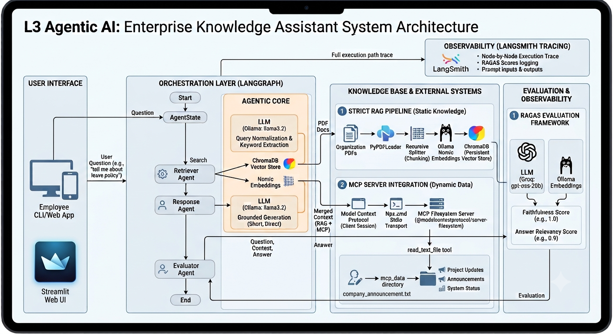

# Enterprise Knowledge Assistant

> **An AI-powered Enterprise Knowledge Assistant built with LangGraph, RAGAS, and Model Context Protocol (MCP)**

---

## 1. System Architecture Overview

The Enterprise Knowledge Assistant unifies static corporate document retrieval (RAG) with real-time dynamic operational data via MCP (Model Context Protocol). Orchestrated using **LangGraph**, the application follows a linear multi-agent workflow: **Retrieve ➔ Respond ➔ Evaluate ➔ End**.

### Architecture Diagram

---

## 2. Setup Instructions

### Prerequisites
- **Python:** 3.10 or higher
- **Node.js:** v18 or higher (required for `@modelcontextprotocol/server-filesystem`)
- **Ollama:** Installed and running locally (`http://localhost:11434`)

### Step 1: Clone Repository & Virtual Environment

git clone <repository_url>
cd Enterprise-Knowledge-Assistant

# Create virtual environment
python -m venv venv
uv venv

# Activate virtual environment
# Windows:
venv\Scripts\activate
# Linux/macOS:
source venv/bin/activate

### Step 2: Install Dependencies

uv add -r requirements.txt

### Step 3: Local LLM & Embedding Setup
Pull required models using Ollama:

ollama pull llama3.2:3b
ollama pull nomic-embed-text

### Step 4: Environment Variables Configuration
Create a `.env` file in the root directory (refer to `.env.example`):

GROQ_API_KEY=your_groq_api_key_here
LANGCHAIN_TRACING_V2=true
LANGCHAIN_API_KEY=your_langsmith_api_key_here
LANGCHAIN_PROJECT=Enterprise-Knowledge-Assistant

---

## 3. Execution Steps

### Step 1: Prepare Knowledge Base & MCP Data
1. Add PDF policy/knowledge documents into the `knowledge/` folder.
2. Ensure dynamic text files (e.g., project updates, system status, company announcements) exist in the `mcp_data/` directory.

### Step 2: Run Application

streamlit run app/streamlit_app.py #Streamlit 
python app/graph.py #Terminal

### Sample Input & Output Execution

======================================================================
       ENTERPRISE KNOWLEDGE ASSISTANT
======================================================================

Enter your question: What is the leave policy?

Loading: knowledge\corporate_policy.pdf
Pages loaded: 12
Total chunks created: 48
ChromaDB vector store created successfully.

======================================================================
FINAL ANSWER
======================================================================
Employees are entitled to 20 days of paid annual leave per calendar year. 
A maximum of 5 unused leave days can be carried over into the following year. 
Leave requests exceeding 3 consecutive days require prior manager approval.

======================================================================
RAGAS EVALUATION
======================================================================
{'faithfulness': 1.0, 'answer_relevancy': 0.9}

Do you want to ask another question? (y/n): n
Thank you for using Enterprise Knowledge Assistant.

---

## 4. RAG Design Document

| Parameter | Specification | Details / Justification |
| :--- | :--- | :--- |
| **Document Source** | Enterprise PDFs (`knowledge/*.pdf`) | Extracted using `PyPDFLoader` from `langchain_community`. |
| **Chunking Strategy** | `RecursiveCharacterTextSplitter` | `chunk_size=500`, `chunk_overlap=50` to maintain contextual boundary integrity across paragraphs. |
| **Embedding Model** | `nomic-embed-text` | Served locally via `OllamaEmbeddings` for strong semantic retrieval capability. |
| **Vector Database** | `ChromaDB` | Embedded persistent storage (`./chroma_db`) performing top-k similarity search (`k=6`). |

---

## 5. LangGraph Design

The execution state graph is constructed using `langgraph.graph.StateGraph` with a linear workflow (**START ➔ Retriever ➔ Response ➔ Evaluator ➔ END**):

### State Object (`AgentState`)
- `question` *(str)*: User input query.
- `context` *(list[str])*: Aggregated list of text chunks from both RAG vector search and MCP file readers.
- `answer` *(str)*: Generated output response.
- `evaluation` *(dict)*: Dictionary containing RAGAS evaluation metrics.

### Agent Nodes & Responsibilities
1. **Retriever Agent (`retriever_agent`):**
   - Queries ChromaDB for top 4 similarity chunks from PDF documents.
   - Triggers MCP tool (`read_text_file`) if query keywords match operational documents (Project Alpha updates, System Status, Announcements).
   - Merges RAG and MCP context into state `context`.
2. **Response Agent (`response_agent`):**
   - Prompts local `llama3.2:3b` model to construct a concise (1–3 sentences) answer grounded strictly in the merged context.
3. **Evaluator Agent (`evaluator_agent`):**
   - Calls RAGAS asynchronous evaluator to compute performance scores on the generated answer against retrieved contexts.

---

## 6. MCP Integration

- **MCP Server Used:** Filesystem MCP Server (`@modelcontextprotocol/server-filesystem`) executed via `npx.cmd`.
- **Tools Exposed:** `read_text_file`
- **Use Case Implemented:** Dynamically inspects and reads real-time text logs and status files from `mcp_data/` (such as `project_alpha_latest_update.txt`, `company_announcement.txt`, and `system_status.txt`) without re-indexing vector databases.

---

## 7. RAGAS Evaluation Results

### Metrics Collected
- **Faithfulness:** Assesses if the generated response is strictly derived from and grounded in the retrieved context.
- **Answer Relevancy:** Measures how directly and concisely the answer addresses the user's initial question.

### Sample Evaluation Results
- **Faithfulness Score:** `1.0000`
- **Answer Relevancy Score:** `0.9000`

### Brief Analysis
- **High Faithfulness (1.0):** Confirms that the strict prompt instructions prevented hallucinations and ensured all assertions were directly verifiable in the context.
- **High Answer Relevancy (0.9):** Demonstrates that removing conversational filler and constraining response length to 1-3 sentences successfully eliminated fluff, keeping the answer directly relevant to the user's question.
